<div align="center">

# Telco Customer Churn Analysis
### Exploratory Data Analysis, Visualization & Deep Learning

**A real-world telecommunications case study using Python and a Keras Multi-Layer Perceptron (MLP)**


**Author:** Tharun Pranav T. · **Roll No.:** 24CS228  
**Department of Computer Science and Engineering**  
KPR Institute of Engineering and Technology, Coimbatore  
**Course:** Exploratory Data Analysis and Visualization · III Year, V Semester

</div>

---

## 📌 Project at a glance

| Dataset | Records | Original features | Target |
|---|---:|---:|---|
| IBM Telco Customer Churn | 7,043 customers | 21 columns | `Churn` (`Yes` / `No`) |

| Test-set metric | Result |
|---|---:|
| Accuracy | **80.23%** |
| Precision | **68.75%** |
| Recall | **47.00%** |
| F1-score | **55.81%** |
| ROC-AUC | **0.839** |

> **Interpretation note:** Accuracy alone does not describe churn detection quality. In this run, recall for the churn class was about 47%, so the model missed a substantial share of customers who actually churned. The threshold used for class predictions was 0.50.

## 🎯 Problem statement

Customer churn occurs when a customer stops using a service. For a telecommunications provider, understanding churn patterns can help identify customer groups that may need retention attention. This project explores customer demographics, service subscriptions, contract details, tenure and billing information, then trains a binary classifier to estimate churn probability.

### Objectives

- Inspect and understand a real-world customer dataset.
- Check data types, missing values and duplicate records.
- Explore churn distribution and relationships between churn and customer attributes.
- Create clear univariate, bivariate and multivariate visualizations.
- Prepare numeric and categorical features using a reproducible preprocessing pipeline.
- Train and evaluate a Keras MLP classifier using a held-out test set.
- Document findings, limitations and potential next steps.

## 🗂️ Dataset

**Source:** IBM Telco Customer Churn sample dataset.  
**Source repository:** [IBM Telco Customer Churn on GitHub](https://github.com/IBM/telco-customer-churn-on-icp4d)

The source dataset contains **7,043 rows and 21 columns**. The prediction target is `Churn`. The dataset includes fields such as `tenure`, `MonthlyCharges`, `TotalCharges`, `Contract`, `InternetService`, `PaymentMethod`, and customer/service attributes.

### Data quality checks recorded for this dataset

- **Missing values:** 11 entries in `TotalCharges` after converting the column to numeric; other columns had no missing values in the inspected summary.
- **Duplicate rows:** 0.
- **Customer identifier:** `customerID` is excluded from the model features.
- **Target encoding:** `No` → `0`; `Yes` → `1`.

The preprocessing pipeline imputes missing numeric values using the training-set median, imputes missing categorical values using the most frequent training-set value, scales numeric features and one-hot encodes categorical features. The original CSV is not required to be committed if you prefer to keep the repository lightweight; the notebook can use the dataset downloaded from the source. If you upload the CSV, verify the dataset's redistribution terms and include the source attribution.

## 🔄 Workflow infographic

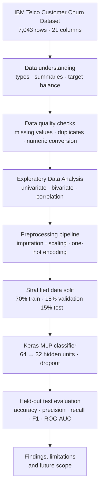

## 📊 Exploratory analysis and charts

The project includes 14 chart images. Once you place the PNG files in the repository's `images/` folder using the filenames below, GitHub will render them in this section.

<details>
<summary><strong>1. Churn distribution</strong></summary>

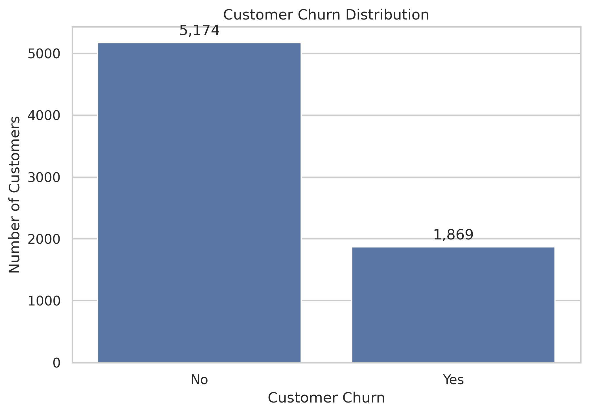

The dataset contains 5,174 customers labelled `No` churn and 1,869 labelled `Yes` churn. This class imbalance is one reason to consider precision, recall, F1-score and ROC-AUC alongside accuracy.
</details>

<details>
<summary><strong>2. Tenure distribution</strong></summary>

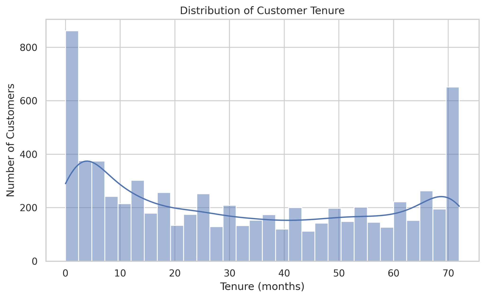
</details>

<details>
<summary><strong>3. Monthly charges distribution</strong></summary>

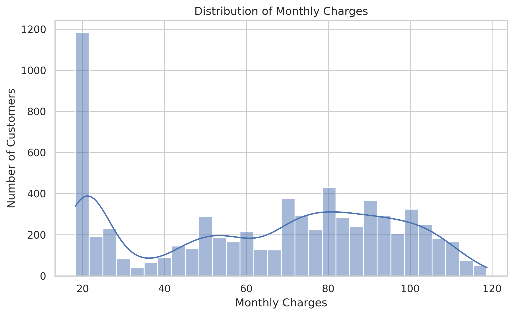
</details>

<details>
<summary><strong>4. Monthly charges by churn</strong></summary>

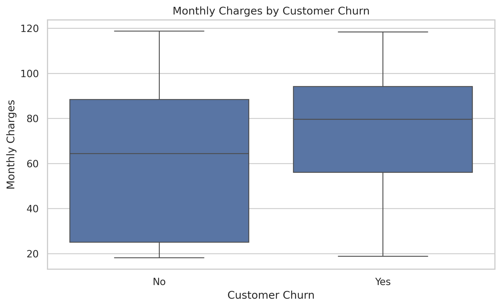
</details>

<details>
<summary><strong>5. Contract type and churn</strong></summary>

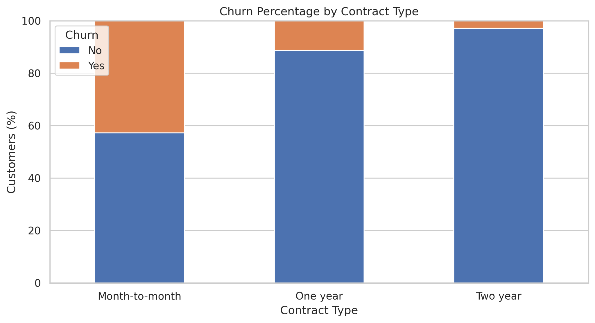
</details>

<details>
<summary><strong>6. Tenure by churn</strong></summary>

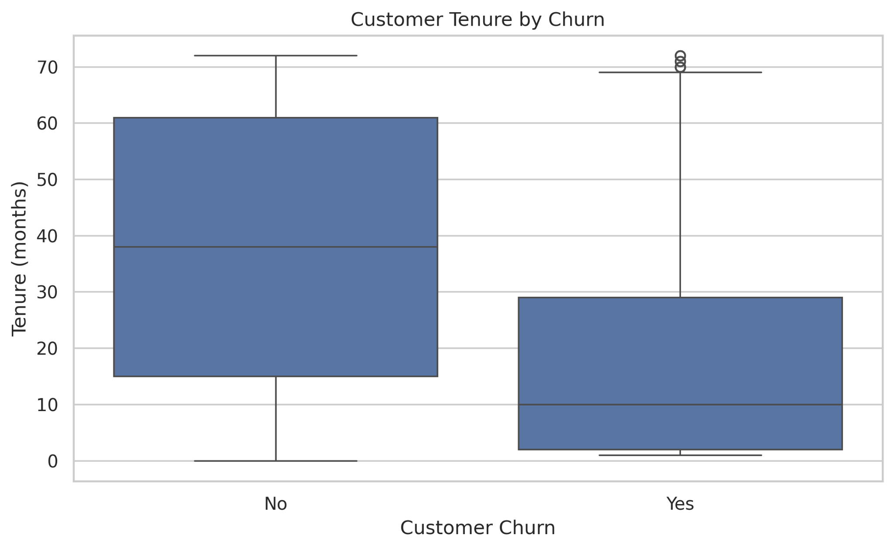
</details>

<details>
<summary><strong>7. Correlation heatmap</strong></summary>

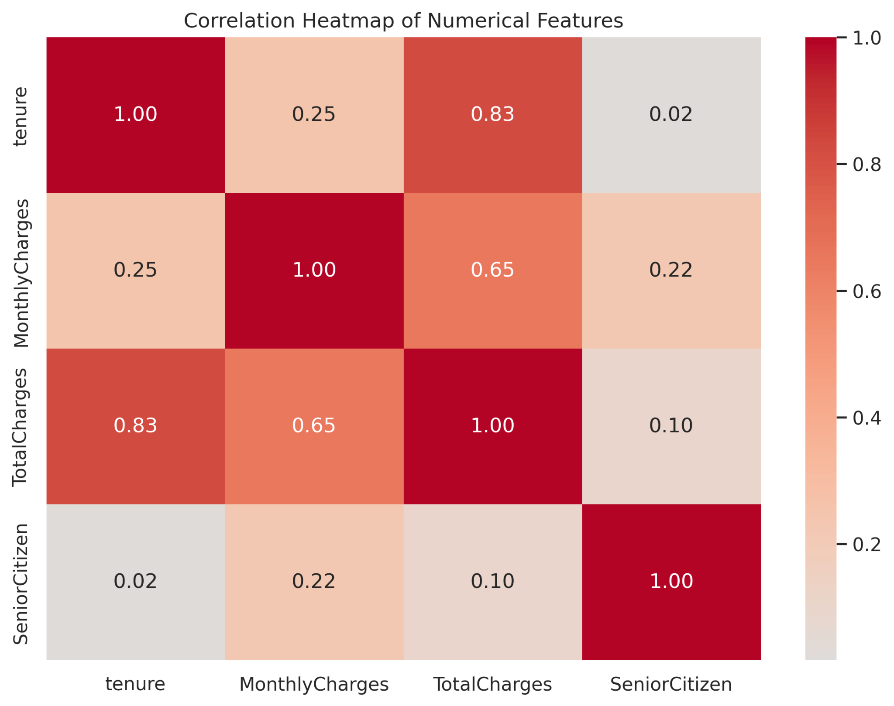

The displayed correlations describe numerical associations; they do not establish causation.
</details>

<details>
<summary><strong>8. Internet service and churn</strong></summary>

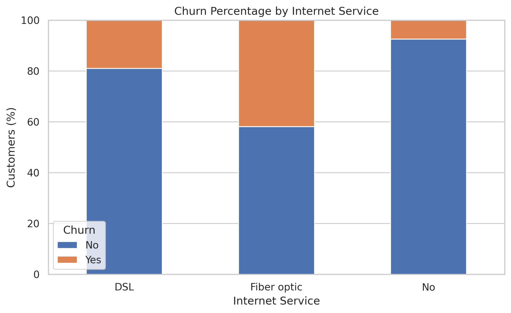
</details>

<details>
<summary><strong>9. Outlier review</strong></summary>

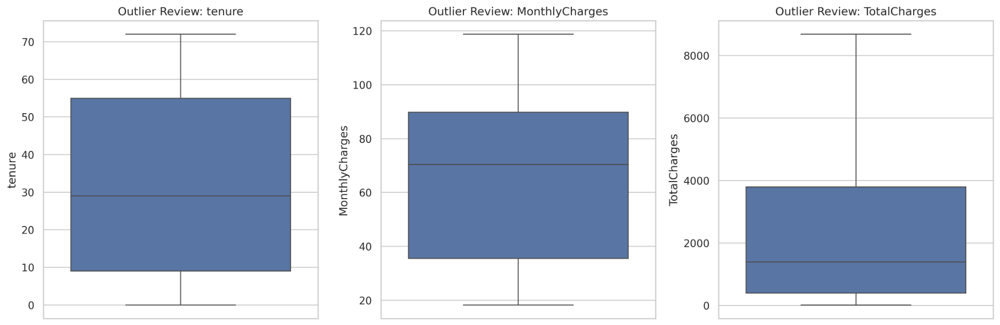

Boxplots flag unusual values for review. An unusual value is not automatically an error, so observations should not be removed without justification.
</details>

## 🧠 Model and evaluation

A **Multi-Layer Perceptron (MLP)** built with TensorFlow/Keras was used for binary classification.

| Component | Configuration |
|---|---|
| Hidden layers | Dense 64 units (ReLU), then Dense 32 units (ReLU) |
| Regularization | Dropout 0.30 and 0.20 |
| Output | 1 unit with sigmoid activation |
| Optimizer | Adam, learning rate 0.001 |
| Loss | Binary cross-entropy |
| Batch size | 32 |
| Maximum epochs | 100, with early stopping on validation loss (patience 10) |
| Prediction threshold | 0.50 |
| Split | Stratified 70% train, 15% validation, 15% test |

### Training and evaluation visuals

| Training loss | Training accuracy |
|---|---|
| 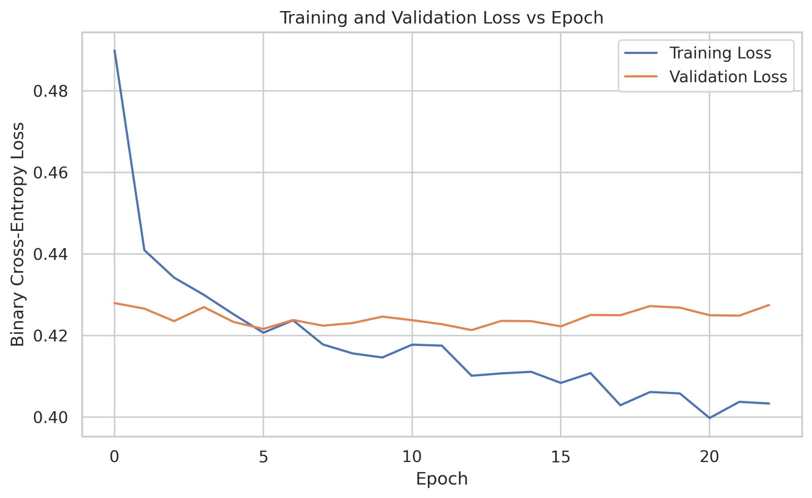 | 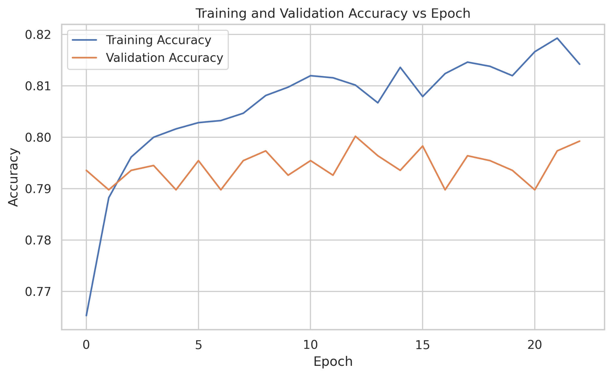 |

| Confusion matrix | ROC curve |
|---|---|
| 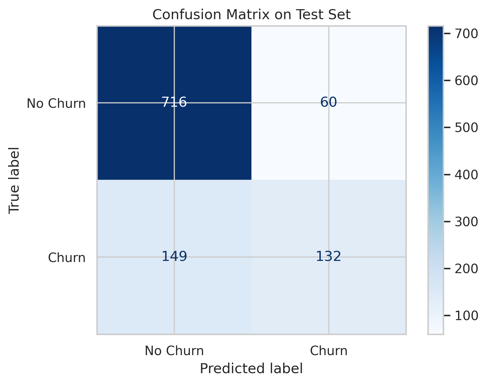 | 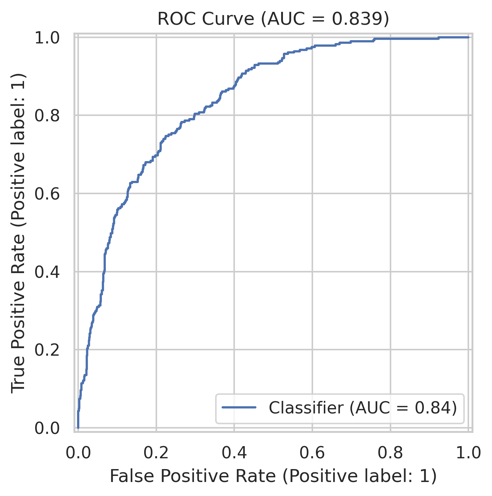 |

**Predicted probability distribution**

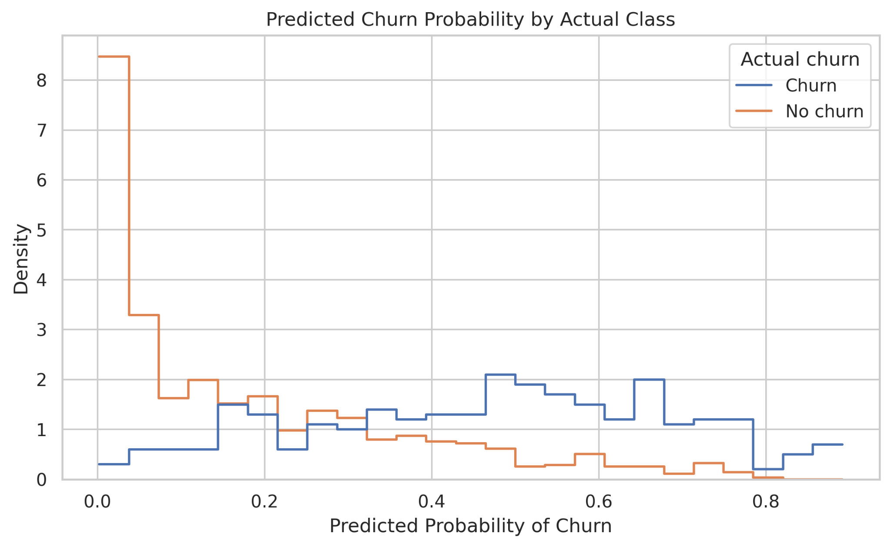

### Test-set metrics

| Metric | Score | What it indicates |
|---|---:|---|
| Accuracy | 0.8023 | Fraction of all test examples classified correctly |
| Precision | 0.6875 | Fraction of predicted churners who actually churned |
| Recall | 0.4698 | Fraction of actual churners detected by the model |
| F1-score | 0.5581 | Harmonic mean of precision and recall |
| ROC-AUC | 0.8391 | Ranking/discrimination ability across thresholds |

The recorded confusion matrix is **716 true negatives, 60 false positives, 149 false negatives and 132 true positives**. The model shows useful ranking ability (ROC-AUC 0.839), but recall at the 0.50 threshold is relatively limited. A business deployment would need threshold selection, validation on newer data and a careful review of the cost of missed churners versus unnecessary retention outreach.

## 🔍 Key findings supported by the charts

- The target is imbalanced: 5,174 customers did not churn and 1,869 did.
- The tenure boxplot shows a lower median tenure among churned customers than among customers who stayed.
- The contract comparison shows the largest churn share for month-to-month contracts.
- The internet-service comparison shows different churn proportions across service categories, with fiber-optic customers showing a higher churn share in this dataset.
- `tenure` and `TotalCharges` have a strong positive correlation in the shown numerical heatmap (approximately **0.83**); `MonthlyCharges` and `TotalCharges` show a moderate positive correlation (approximately **0.65**).
- These are observational patterns and should not be interpreted as proof of causation.

## 🛠️ Technology stack

- **Python** — analysis and workflow
- **Pandas, NumPy** — data manipulation and numerical operations
- **Matplotlib, Seaborn** — visualization
- **scikit-learn** — train/validation/test splitting, preprocessing and evaluation metrics
- **TensorFlow / Keras** — MLP model training
- **Jupyter Notebook / Google Colab** — execution environment

## 🚀 How to run

### Option A — Google Colab (recommended for a quick run)

1. Upload `notebooks/Telco_Customer_Churn_EDA_Deep_Learning.ipynb` to [Google Colab](https://colab.research.google.com/).
2. Upload `Telco-Customer-Churn.csv` when prompted, or make it available in the notebook's working directory.
3. Run the notebook cells from top to bottom.
4. Review the printed data-quality summary, plots and final evaluation metrics.
5. Download the generated outputs if you want to store them under `outputs/`.

### Option B — Run locally

```bash
git clone https://github.com/<YOUR-USERNAME>/telco-customer-churn-eda-deep-learning.git
cd telco-customer-churn-eda-deep-learning

python -m venv .venv
# Windows:
.venv\Scripts\activate
# macOS/Linux:
source .venv/bin/activate

pip install -r requirements.txt
jupyter notebook notebooks/Telco_Customer_Churn_EDA_Deep_Learning.ipynb
```

Keep `Telco-Customer-Churn.csv` in the notebook's working directory, or update `DATA_PATH` in the notebook to point to the CSV location. The notebook includes a Google Colab upload fallback.

> **Reproducibility:** Deep-learning results can vary with library versions and hardware. The metrics in this README describe the saved run documented with this project; rerunning the notebook may produce slightly different values.

## 📁 Repository structure

```text
telco-customer-churn-eda-deep-learning/
├── README.md
├── requirements.txt
├── .gitignore
├── data/
│   └── README.md                  # Dataset source and placement instructions
├── notebooks/
│   └── Telco_Customer_Churn_EDA_Deep_Learning.ipynb
├── images/
│   ├── 01_churn_distribution.png
│   ├── 02_tenure_distribution.png
│   ├── 03_monthly_charges_distribution.png
│   ├── 04_monthly_charges_by_churn.png
│   ├── 05_contract_type_vs_churn.png
│   ├── 06_tenure_by_churn.png
│   ├── 07_correlation_heatmap.png
│   ├── 08_internet_service_vs_churn.png
│   ├── 09_outlier_review.png
│   ├── 10_training_loss_curve.png
│   ├── 11_training_accuracy_curve.png
│   ├── 12_confusion_matrix.png
│   ├── 13_roc_curve.png
│   └── 14_predicted_probability_distribution.png
├── outputs/
│   ├── dataset_summary.txt
│   ├── descriptive_statistics.csv
│   ├── missing_values.csv
│   └── model_evaluation_metrics.csv
└── reports/
    ├── Telco_Customer_Churn_EDA_Project_Report.pdf
    └── Telco_Customer_Churn_EDA_Project_Report.docx
```

The `reports/` and `outputs/` files listed above should be copied into those folders before committing. The raw dataset CSV is optional; see `data/README.md`.

## 📄 Report and supporting outputs

- **Project report:** export the final formatted Word report to PDF and place both files in `reports/`.
- **Dataset summary:** `outputs/dataset_summary.txt`
- **Descriptive statistics:** `outputs/descriptive_statistics.csv`
- **Missing-value summary:** `outputs/missing_values.csv`
- **Model metrics:** `outputs/model_evaluation_metrics.csv`

Only include output files that exist and correspond to the notebook run you are submitting. Do not manually edit metrics to make them look better.

## ⚠️ Limitations and future work

- This is a sample dataset and may not represent every telecommunications provider or current customer population.
- Correlation and group-level comparisons are observational, not causal.
- Recall at the selected 0.50 threshold is limited.
- The model should be compared with a simple baseline and alternative classifiers.
- Future work could tune the classification threshold, compare logistic regression and tree-based models, use cross-validation, apply explainability methods, and evaluate on newer customer data.

## 📚 References

1. IBM, “Telco Customer Churn,” sample dataset and project materials. [GitHub repository](https://github.com/IBM/telco-customer-churn-on-icp4d).
2. TensorFlow, “The Sequential model.” [Documentation](https://www.tensorflow.org/guide/keras/sequential_model).
3. scikit-learn developers, “ColumnTransformer.” [Documentation](https://scikit-learn.org/stable/modules/generated/sklearn.compose.ColumnTransformer.html).
4. scikit-learn developers, “Model evaluation: quantifying the quality of predictions.” [Documentation](https://scikit-learn.org/stable/modules/model_evaluation.html).
5. McKinney, W., *Python for Data Analysis*. O’Reilly Media. Cite the edition/year used in the submitted report.

---

<div align="center">

**Academic project · Exploratory Data Analysis and Visualization**  
Made by **Tharun Pranav T.** · KPR Institute of Engineering and Technology

</div>
